<div align="center">

# RAIA

**A natação universitária InterUSP e TUSCA (2023–2026) numa piscina 3D, com análise visual interativa.**

Monte seu nadador, nade contra os finalistas reais e investigue as provas com visões coordenadas.

[**raia.jaderlouis.com.br**](https://raia.jaderlouis.com.br) · Projeto de Visualização Computacional · ICMC-USP · 2026

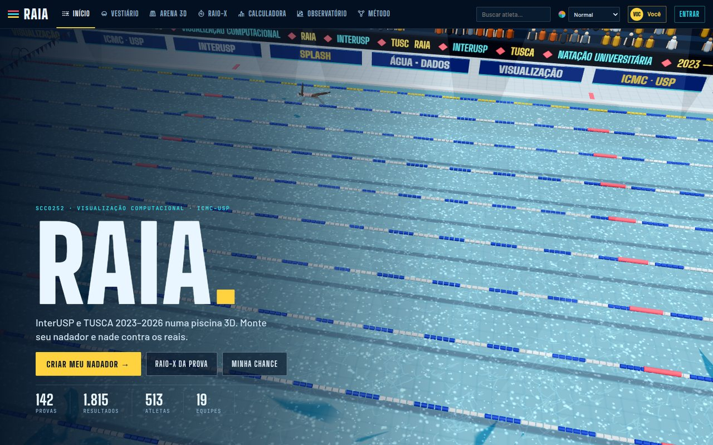

</div>

---

## Sumário

- [Entregas: release-1 e release-2](#entregas-release-1-e-release-2)
- [Propósito](#propósito)
- [Questões investigadas](#questões-investigadas)
- [O conjunto de dados](#o-conjunto-de-dados)
- [As sete telas](#as-sete-telas)
- [Interação e visões coordenadas](#interação-e-visões-coordenadas)
- [Acessibilidade](#acessibilidade)
- [Conta por nome e ranking dos visitantes](#conta-por-nome-e-ranking-dos-visitantes)
- [Arquitetura](#arquitetura)
- [Rodar localmente](#rodar-localmente)
- [Testes](#testes)
- [Publicação](#publicação)
- [Estrutura do repositório](#estrutura-do-repositório)
- [Limitações](#limitações)

## Entregas: release-1 e release-2

O projeto é entregue em duas etapas, e a variável `RAIA_RELEASE` define o que a interface mostra.

- **release-1 (1ª entrega, 15/11/2026)** é a versão no ar e a que esta etapa avalia: Início, Vestiário, Arena 3D com placar e câmeras, Raio-X, Método (Q1, Q2, Q3 e Q6) e o Observatório com Enxame, Nível, Ranking e Equipe × prova.
- **release-2 (2ª entrega, 03/12/2026)**: a Calculadora, as visões Perfis, Coordenadas, Combinações e Concentração (Q4 e Q5), as duas visões lado a lado com seleção ligada, o pincel no Enxame e os gráficos sincronizados da Arena **já estão implementados neste código**, mas ficam desligados na release-1. Os pontos de corte estão marcados com comentários `release-2` no código.

Este README descreve o projeto completo; as seções sobre as partes acima valem a partir da release-2.

## Propósito

A RAIA é o projeto prático da disciplina **SCC5836 — Visualização Computacional** (ICMC-USP, 2026/2). O enunciado pede um conjunto de dados real, ligado à vida universitária, explorado com várias técnicas de visualização e interação, sem ferramentas prontas como Power BI ou Tableau.

O tema é a natação das duas maiores competições universitárias paulistas: o **InterUSP**, entre as atléticas da USP, e o **TUSCA**, o torneio de São Carlos. As súmulas oficiais viraram uma base única de provas, atletas, equipes e tempos. Em cima dessa base, a RAIA junta duas experiências:

1. **Sentir a prova.** O visitante monta um nadador no Vestiário e nada a final real do ano e da prova que escolher, numa piscina 3D com câmeras de transmissão, placar ao vivo e gráficos sincronizados com o tempo da corrida.
2. **Entender os dados.** O Raio-X, a Calculadora e o Observatório respondem perguntas concretas sobre nível técnico, equilíbrio entre competições, especialização das equipes e perfis de atletas, com visões ligadas entre si.

## Questões investigadas

Cada questão tem um atalho na tela **Método**, que leva direto à visão que a responde.

| # | Questão | O que os dados mostram | Visão |
|---|---|---|---|
| Q1 | O nível está subindo? | Índice Técnico (IT) mediano: InterUSP 556 → 524 e TUSCA 633 → 527 entre 2023 e 2026 | Nível |
| Q2 | InterUSP e TUSCA têm o mesmo nível? | IT mediano de 529 contra 547 | Enxame |
| Q3 | Quem domina cada prova? | Blocos de especialização por equipe, com ranking por edição | Matriz equipe × prova |
| Q4 | Existem perfis de atletas? | k-means com 4 grupos sobre a PCA dos perfis multiprovas | Perfis |
| Q5 | Os pontos dependem de poucos atletas? | Curvas de Lorenz e índice de Gini por equipe | Concentração |
| Q6 | Onde se perde tempo para a elite? | No nado (57%), na saída (16%) e nas viradas (21%) | Raio-X |

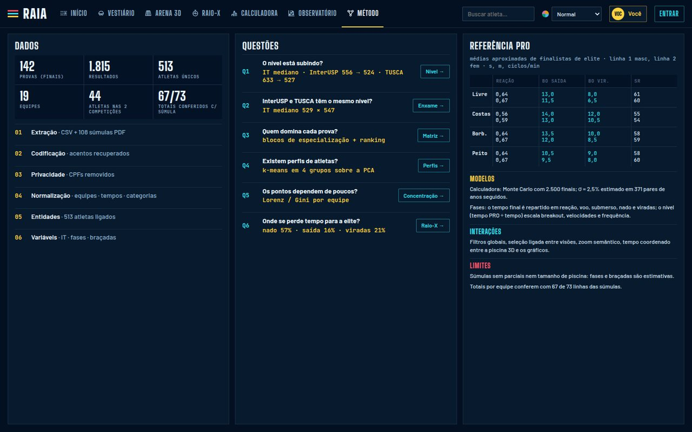

## O conjunto de dados

| | |
|---|---|
| Provas (finais) | **142** (InterUSP 2023–2026 e TUSCA 2023–2026) |
| Resultados | **1.816** |
| Atletas únicos | **504** (45 nadaram nas duas competições) |
| Equipes | **19** |
| Validação | os totais por equipe conferem com **65 de 71** linhas das súmulas gerais |

**Fontes:** a planilha consolidada do InterUSP 2023–2025 e as súmulas em PDF do TUSCA 2023–2026 e do InterUSP 2026, uma por prova, mais a classificação geral por equipes.

**Pipeline**, também resumido na tela Método:

1. **Extração:** CSV e 108 súmulas PDF.
2. **Codificação:** recuperação de acentos quebrados na extração.
3. **Privacidade:** remoção dos CPFs que apareciam nas súmulas do TUSCA 2026.
4. **Normalização:** nomes de equipes, formatos de tempo e categorias.
5. **Entidades:** o mesmo atleta é ligado entre edições e competições (504 atletas).
6. **Variáveis derivadas:** Índice Técnico, fases da prova e braçadas estimadas.

O código está em `dados/construir.py`, e as fontes e as correções estão em [`dados/FONTES.md`](dados/FONTES.md). O resultado é um único `web/data/natacao.json` (189 KB) com provas, atletas, resultados e regras de pontuação. Os arquivos brutos não estão no repositório, e uma verificação automática impede que qualquer CPF entre no Git ou na imagem Docker (veja [Testes](#testes)).

## As sete telas

### Vestiário

Um nadador 3D parametrizável: nome, sigla, equipe, corpo, traje, touca, óculos e comemoração. É ele quem cai na água na Arena.

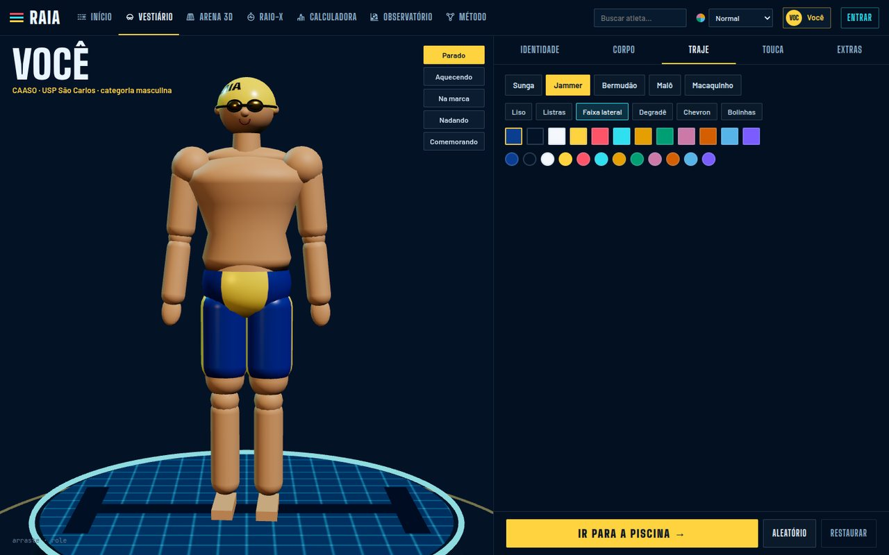

### Arena 3D

O visitante digita o próprio tempo e nada contra os finalistas reais da prova e do ano escolhidos. Também dá para nadar contra os campeões de todas as edições ou contra os melhores tempos da história. A tela tem câmeras de TV, aérea, de bloco e de seguir um nadador, placar ao vivo, replay com linha do tempo e um painel com 11 gráficos sincronizados com a corrida:

- resultado;
- fita de fases;
- ida × volta;
- parciais e breakouts;
- velocidade;
- SR × DPS;
- braçadas;
- perda para a elite;
- diagrama espaço-tempo;
- mapa de vantagem;
- ranking dos visitantes.

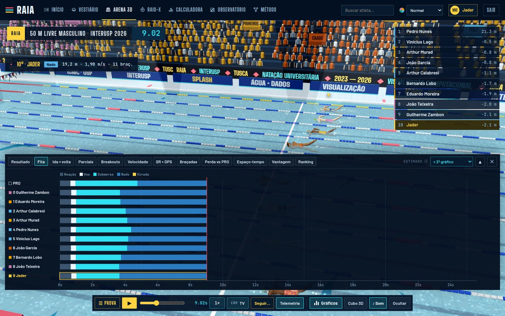

### Raio-X

A anatomia de uma final, ou de todas as provas ao mesmo tempo, em oito gráficos ligados:

- fita de fases (reação, voo, submerso, nado, viradas);
- ida × volta;
- parciais;
- breakouts na piscina;
- velocidade;
- frequência × distância por ciclo;
- cada braçada;
- onde se perde tempo para a referência PRO.

Um editor de técnica permite ajustar o próprio perfil de fases e ver o efeito.

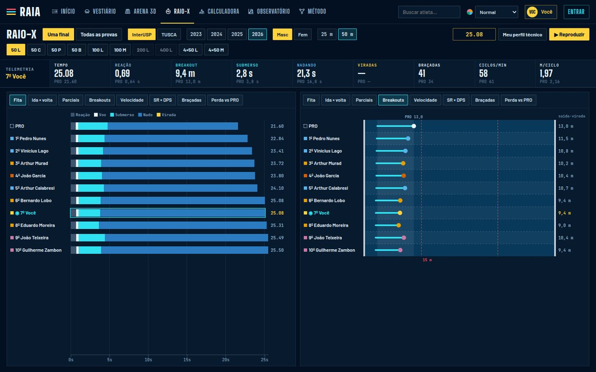

### Calculadora

Responde "com o meu tempo, quais são as minhas chances?". Ela estima a chance de ouro, pódio e pontuação por **Monte Carlo** (2.500 finais simuladas, σ = 2,5% estimado em 371 pares de anos seguidos), em dois modos: média dos anos ou todos os anos juntos por *bootstrap*.

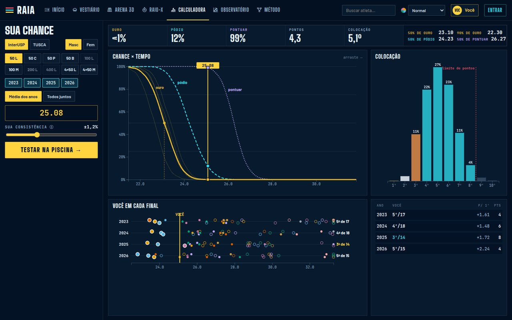

### Observatório

Duas visões lado a lado, coordenadas pelos mesmos filtros e pela mesma seleção, escolhidas entre oito técnicas:

| Visão | Técnica | Interação |
|---|---|---|
| Enxame | *beeswarm* do Índice Técnico de cada resultado | arraste para selecionar |
| Nível | *ridgeline* da densidade do IT por edição | filtros e seleção ligada |
| Ranking | *bump chart* das equipes por edição | filtros e seleção ligada |
| Equipe × prova | matriz com a fatia dos pontos de cada prova | filtros e seleção ligada |
| Perfis | PCA + k-means dos perfis multiprovas | laço e zoom semântico |
| Coordenadas | coordenadas paralelas do melhor IT por prova | *brushing* nos eixos |
| Combinações | diagrama de cordas das provas nadadas pelo mesmo atleta | filtros e seleção ligada |
| Concentração | curvas de Lorenz dos pontos por equipe | filtros e seleção ligada |

Clicar num atleta abre a ficha dele, com trajetória, radar e melhores marcas.

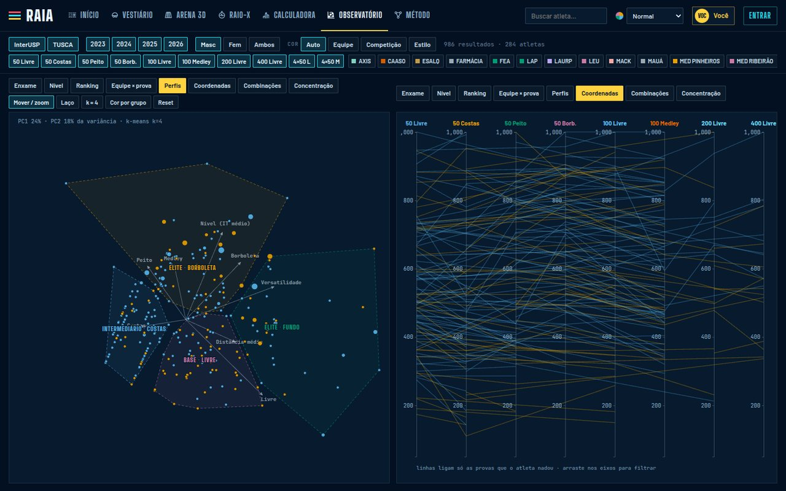

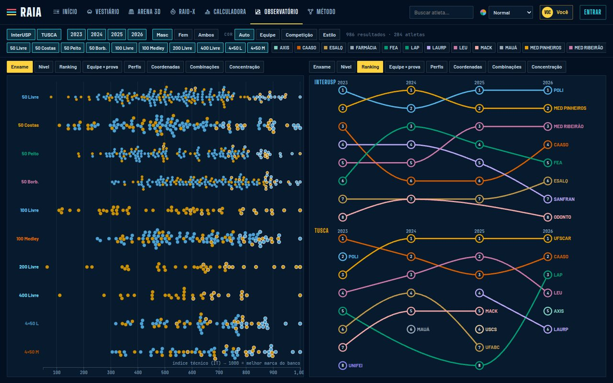

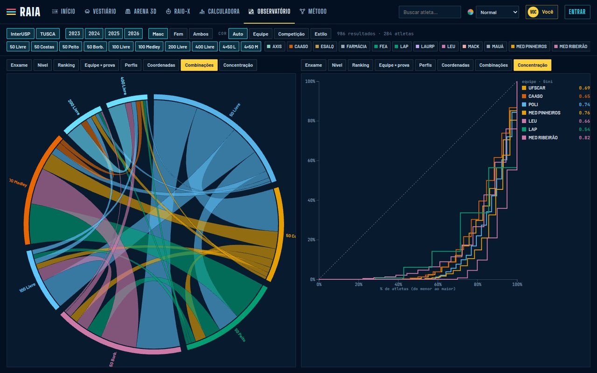

### Método

Reúne os números da base, o pipeline, as questões com atalhos para as visões, os modelos, as interações, os limites e a tabela de referência PRO (médias aproximadas de finalistas de elite).

## Interação e visões coordenadas

- **Filtros globais (*dynamic query*):** competição, ano, sexo, prova e equipe atualizam todas as visões juntas.
- **Linking + brushing:** uma seleção feita no enxame, no laço da PCA ou nos eixos das coordenadas paralelas destaca os mesmos resultados nas outras visões.
- **Zoom semântico** na PCA: aproximar revela rótulos e detalhes que não cabem na visão geral.
- **Tempo coordenado:** a piscina 3D, o placar e os gráficos da Arena compartilham o mesmo relógio. Passar o mouse num nadador num gráfico destaca o mesmo nadador nos outros, e clicar faz a câmera segui-lo.
- **Detalhes sob demanda:** fichas de atleta, *tooltips* e a busca por atleta no topo da página.

## Acessibilidade

- Cores categóricas da paleta **Okabe–Ito**, segura para daltonismo, nos estilos e nas equipes.
- **Simulador de daltonismo** no topo da página: protanopia, deuteranopia, tritanopia e acromatopsia, aplicado à página inteira com filtros SVG.
- Layout que se adapta ao celular, com o header em duas linhas em telas estreitas.

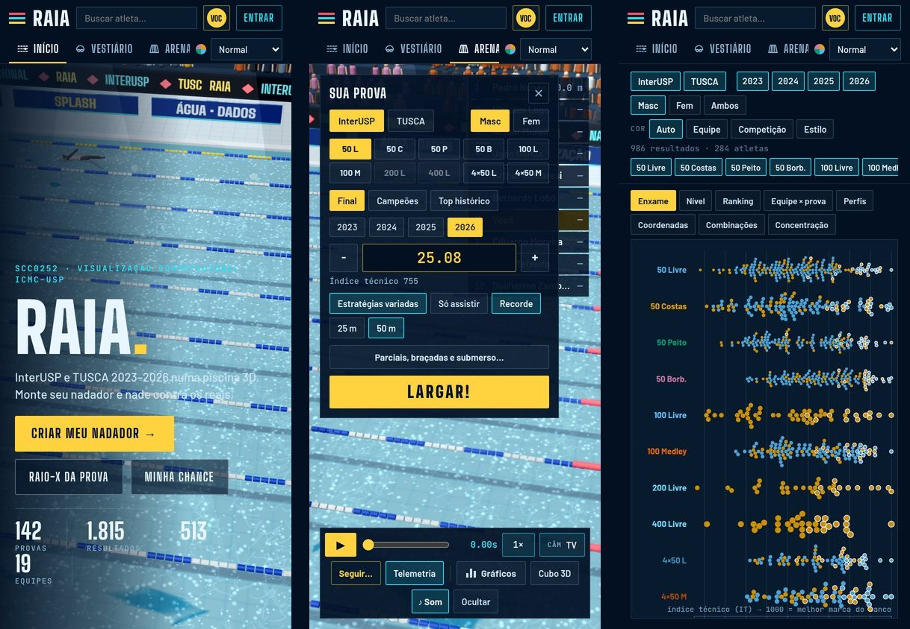

## Conta por nome e ranking dos visitantes

Ver o site não exige conta. Quem quiser pode **entrar só com um nome**, sem senha:

- o nadador do Vestiário e a técnica ficam salvos no servidor;
- cada prova corrida na Arena entra no **ranking dos visitantes** daquela prova, sexo e piscina, que é a última aba do painel de gráficos.

<p align="center">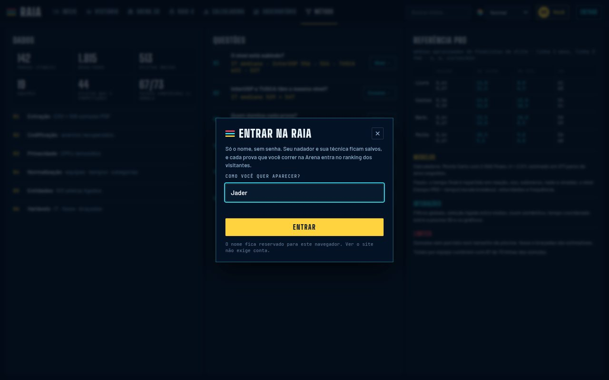 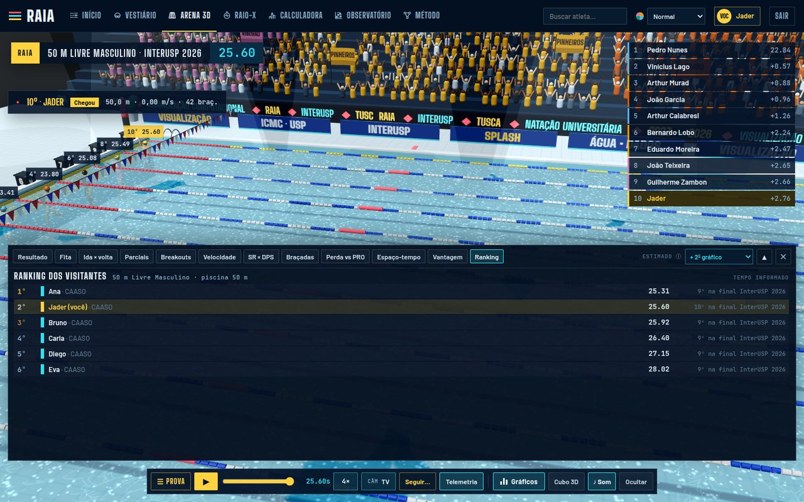</p>

**Como funciona, sem senha e sem roubo de nome:**

- O navegador recebe um identificador de aparelho aleatório num cookie `HttpOnly`, e o nome fica reservado para esse aparelho.
- Outra pessoa que tentar o mesmo nome recebe "esse nome já tem dono". Acentos e maiúsculas não contornam a regra: "João" e "joao" são o mesmo nome.
- Sair e voltar no mesmo aparelho recupera o nome.
- O servidor guarda só o *hash* dos tokens.
- Há limite de tentativas por IP, checagem de origem nas escritas e validação de tudo o que chega, inclusive de tempos plausíveis: nenhum tempo abaixo de 90% do melhor da base real.

O ranking registra o **tempo informado** pelo visitante na Arena e o lugar que esse tempo teria na final real. É um jogo, não uma medição.

## Arquitetura

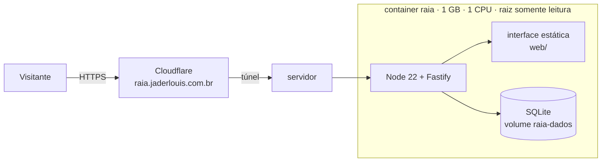

**Front-end:** uma página única (`web/RAIA.dc.html`) com runtime de templates próprio (`web/support.js`) sobre **React 18**, cenas 3D em **three.js 0.184** e gráficos em **d3 7.9**. Todas as dependências e fontes são servidas do próprio site (`web/vendor/`), então nada depende de CDN.

**Back-end** (`server/`): **Fastify 5** com **better-sqlite3**. Ele serve a interface e cinco rotas de API:

| Rota | Função |
|---|---|
| `GET /api/eu` | sessão atual, nadador e técnica salvos |
| `POST /api/sessao` · `DELETE /api/sessao` | entrar com um nome · sair |
| `PUT /api/eu/avatar` · `PUT /api/eu/tec` | salvar o nadador e a técnica |
| `POST /api/resultados` | registrar uma prova (guarda o melhor tempo) |
| `GET /api/ranking?code=&sex=&pool=` | top 20 e a posição de quem está conectado |

**Segurança:**

- CSP restrita à própria origem;
- `frame-ancestors 'none'`, `nosniff` e `Referrer-Policy`;
- cookies `HttpOnly`, `Secure` e `SameSite=Lax`;
- *rate limit* e corpo de requisição limitado a 32 KB;
- container sem privilégios, com `cap_drop: ALL` e `no-new-privileges`.

## Rodar localmente

Requisitos: Node 22 ou mais novo.

```bash
git clone https://github.com/Prism411/raia-scc5836.git && cd raia-scc5836
npm install                 # ferramentas de teste e vendorização
(cd server && npm install)  # servidor
npm run dev                 # http://localhost:8080
```

Só a interface, sem conta nem ranking, também funciona como arquivo estático:

```bash
cd web && python3 -m http.server 8000   # http://localhost:8000/RAIA.dc.html
```

Com Docker:

```bash
docker build -t raia .
docker run --rm -p 8080:8080 -e RAIA_COOKIE_SECURE=0 -v raia-dados:/dados raia
```

## Testes

| Comando | O que verifica |
|---|---|
| `npm run test:api` | API: sessão, nome tomado (409), salvamento, ranking, limites de tempo, CSRF e *rate limit* |
| `npm run test:fumaca` | percorre as 7 abas, as 8 visões do Observatório, os 8 gráficos do Raio-X, os dois modos da Calculadora e uma corrida completa, e falha com qualquer erro no console ou resposta HTTP de erro |
| `npm run test:conta` | ponta a ponta no navegador: entrar, salvar, correr, ranking, recarregar, nome tomado no celular, sair e voltar |
| `npm run cpf` | garante que nenhum arquivo versionado contém CPF |

Os testes de navegador usam o Chromium do Playwright com WebGL por software, então rodam sem GPU.

## Moderação do ranking

```bash
docker exec raia node scripts/admin.js listar
docker exec raia node scripts/admin.js remover "Nome"
```

## Estrutura do repositório

```
web/                 interface servida
  RAIA.dc.html       página única com as sete telas
  support.js         runtime de templates
  raia-conta.js      conta por nome, salvamento e ranking
  js/                núcleo de dados, nadador, arena, som, modelos e gráficos
  data/natacao.json  base consolidada
  vendor/            React, three.js, d3 e fontes locais
server/              API Fastify + SQLite e testes
tests/               fumaça, conta e comparação visual
scripts/             vendorização e guarda de CPF
docs/img/            imagens deste README
```

## Limitações

- As súmulas não trazem parciais nem tamanho de piscina. Por isso fases, parciais e braçadas são **estimativas** calibradas por médias de finalistas de elite, sinalizadas como "ESTIMADO" na interface.
- Os totais por equipe conferem com 65 de 71 linhas das súmulas gerais. As diferenças vêm de critérios de desempate e de provas de demonstração.
- O ranking dos visitantes usa o tempo que cada pessoa informa.
- Os nomes de atletas vêm das súmulas oficiais, que as competições já publicam. Nenhum CPF ou outro documento pessoal faz parte da base.

---

<div align="center">

Feito por **Jader Louis** · Mestrado · ICMC-USP

</div>
